

  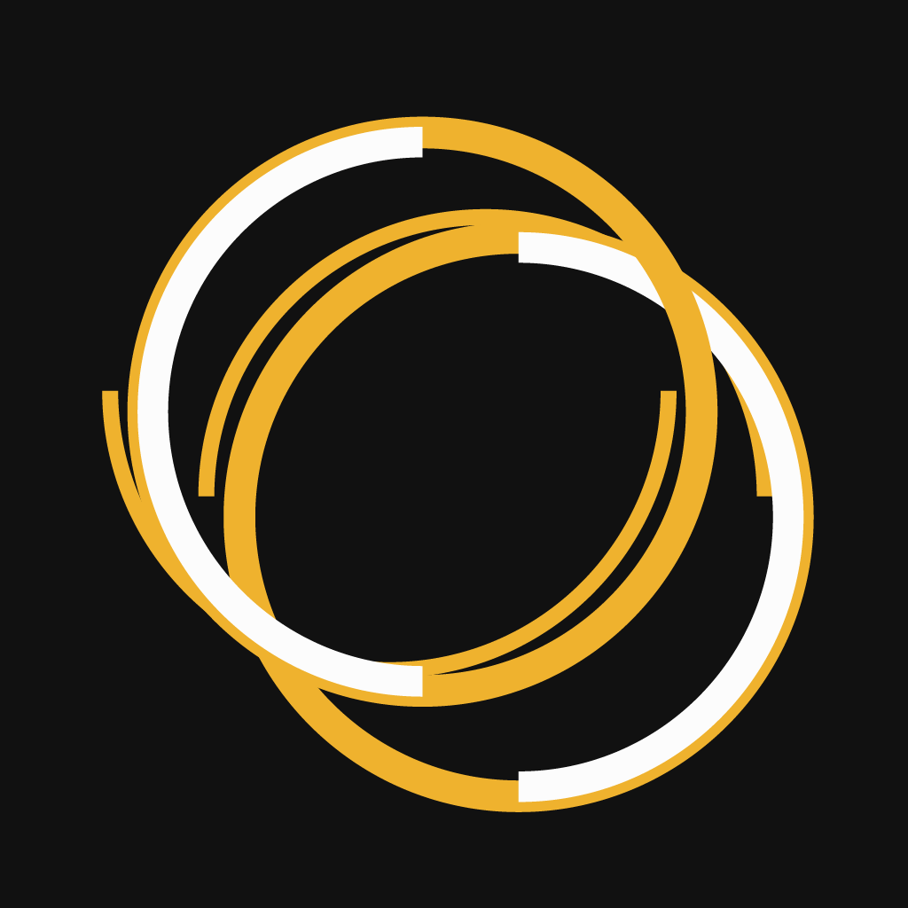
  <h1>SaberShader</h1>
  
<strong>Profile-based toon and anime shading for Blender</strong>

  
Shaders estilizados por perfiles para Blender

  
<strong>Current release: 1.0.4</strong> · <strong>Designed for Blender 5.1.1+</strong>

**[English](#english)** · **[Español](#español)** · **[Gallery / Galería](#gallery)** · **[Releases](https://github.com/XDZR8/SaberShader/releases)** · **[Report an issue](https://github.com/XDZR8/SaberShader/issues/new)**

  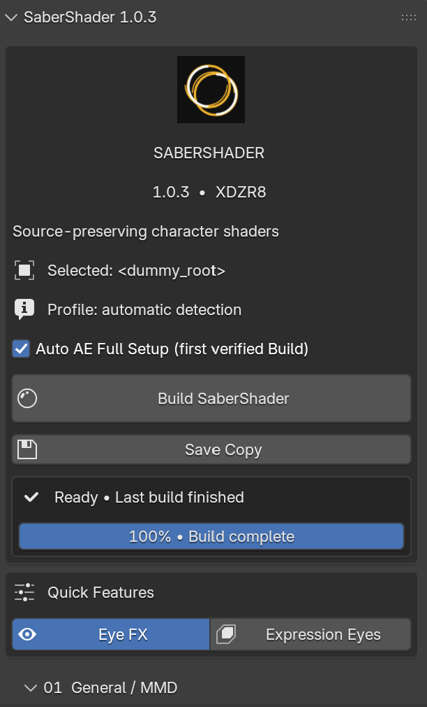

<em>SaberShader interface / Interfaz de SaberShader</em>

---

## English

### What is SaberShader?

SaberShader is a Blender add-on that creates stylized, toon/anime-inspired material setups. Its profiles help adapt shader construction and diagnostic tools to different model and texture workflows.

**Available profiles in version 1.0.3:**

| Profile | Intended workflow |
| --- | --- |
| **General / MMD** | General-purpose and imported MMD-style models, material-name dictionary, texture recognition, optional manual material-role assignment. |
| **Uma Musume** | Character shading adjustments, texture checks and optional user-provided expression-eye overlays. |
| **Arknights: Endfield** | Face, hair, eyes, cloth, outlines and source-dependent diagnostics. |
| **FGO Arcade** | Source audits, material setup, facial/UV tools, outlines and related adjustments. |

You can try **General / MMD** on your own model. Recognition depends on available materials, texture names and the add-on's evolving dictionary; results are not guaranteed for every model. Specialized workflows may require specific source textures or naming conventions.

### Requirements and compatibility

- **Blender 5.1.1 or newer** is the project's declared target. Features in other versions should be checked before relying on them in production.
- An imported character or model, ideally with its original materials and textures available.
- A saved backup of the `.blend` project before using any material-rebuilding or cleanup tools.
- Some profile-specific previews and lighting workflows are intended for **EEVEE**; check the relevant tool's requirements.

### Installation

1. Open the **[SaberShader releases page](https://github.com/XDZR8/SaberShader/releases/tag/V1_0_3)** and download the **installable add-on package** (latest current version).
2. Launch Blender and open **Edit → Preferences**.
3. In **Get Extensions** or **Add-ons**, open the top-right menu and choose **Install from Disk**.
4. Select the downloaded add-on ZIP. Keep the package zipped during installation.
5. Enable **SaberShader** if it is not already enabled.
6. Return to the **3D Viewport**, press **N** to open the sidebar, and select the **SaberShader** tab.

  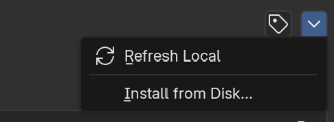

For more screenshots of the add-on interface, see the [visual gallery](#gallery).

### Basic usage

1. Import your model and make sure the materials and textures you want to use are available.
2. Select the relevant character or object and review the available SaberShader profile settings.
3. Choose or confirm the appropriate workflow. Use **General / MMD** for models without a specialized profile.
4. Press **Build SaberShader** to create or update the shader setup for the selected workflow.
5. Inspect the materials and result in the viewport. Profile-specific advanced tools, audits and recovery options are optional; read their descriptions before applying them.

**Important:** The build process can modify Blender materials and scene configuration. Work on a saved copy when evaluating a new model. Exact results depend on source material organization, textures and profile support.

### What is not included

SaberShader does **not** distribute extracted game models, textures, animations, expression-eye images or other copyrighted third-party artwork. Users supply any required assets themselves and are responsible for using material they have permission to use.

References to Uma Musume, Arknights: Endfield and Fate/Grand Order Arcade identify compatible workflows only. SaberShader is an independent community project and is not affiliated with, endorsed by or supported by the respective rights holders.

### Known limitations and bug reports

- Material-name and texture recognition are not universal; unrecognized models may require manual configuration.
- Some profile-specific tools are source-dependent and may behave differently between models.
- The **1.0.3 release notes** specifically note that the **FGO Arcade outline may need further work** and that testing was limited to Saber.

Found a bug? **[Open a new GitHub issue](https://github.com/XDZR8/SaberShader/issues/new)** and include your Blender version, SaberShader version, selected profile, steps to reproduce, expected and actual results, relevant console errors, and a screenshot if possible. Do not upload copyrighted game assets without permission.

### License and credits

Created by **XDZR8**. SaberShader is licensed under the **GNU General Public License v3.0 (GPL-3.0)**. See [LICENSE](./LICENSE) for the full license text and the add-on package’s `THIRD_PARTY_NOTICES.md` for third-party notices.

---

## Español

### ¿Qué es SaberShader?

SaberShader es un complemento de Blender que crea materiales de aspecto estilizado, tipo **toon/anime**. Sus perfiles permiten adaptar la construcción de shaders y las herramientas de diagnóstico a distintos tipos de modelos y texturas.

**Perfiles disponibles en la versión 1.0.3:**

| Perfil | Uso previsto |
| --- | --- |
| **General / MMD** | Modelos generales o importados desde MMD, diccionario de nombres de materiales, reconocimiento de texturas y asignación manual opcional de funciones de material. |
| **Uma Musume** | Ajustes de sombreado del personaje, comprobaciones de texturas y superposiciones opcionales de ojos y expresiones aportadas por el usuario. |
| **Arknights: Endfield** | Cara, pelo, ojos, ropa, contornos y diagnósticos dependientes de los archivos de origen. |
| **FGO Arcade** | Auditorías de archivos de origen, materiales, herramientas faciales/UV, contornos y ajustes relacionados. |

Puedes probar **General / MMD** con tu propio modelo. El reconocimiento depende de los materiales disponibles, los nombres de las texturas y el diccionario del complemento, que sigue evolucionando; no se garantizan resultados para todos los modelos. Los flujos de trabajo especializados pueden requerir texturas de origen específicas o determinadas convenciones de nombres.

### Requisitos y compatibilidad

- **Blender 5.1.1 o posterior** es el objetivo de compatibilidad declarado por el proyecto. Conviene comprobar el funcionamiento de las herramientas en otras versiones antes de utilizarlas en producción.
- Un modelo importado, preferiblemente con sus materiales y texturas originales disponibles.
- Una copia de seguridad del proyecto `.blend` antes de reconstruir materiales o ejecutar herramientas de limpieza.
- Algunas funciones específicas de iluminación y previsualización están orientadas a **EEVEE**; consulta los requisitos de cada herramienta.

### Instalación

1. Abre la **[página de versiones de SaberShader](https://github.com/XDZR8/SaberShader/releases/tag/V1_0_3)** y descarga el **paquete instalable del complemento** (última versión actual).
2. Abre Blender y entra en **Edit → Preferences**.
3. En **Get Extensions** o **Add-ons**, abre el menú de la esquina superior derecha y selecciona **Install from Disk**.
4. Selecciona el ZIP descargado del complemento. No lo descomprimas durante la instalación.
5. Activa **SaberShader** si Blender no lo ha activado automáticamente.
6. Vuelve al **3D Viewport**, pulsa **N** para abrir la barra lateral y selecciona la pestaña **SaberShader**.

  

Para ver más capturas de la interfaz, consulta la [galería visual](#gallery).

### Uso básico

1. Importa tu modelo y comprueba que sus materiales y texturas estén disponibles.
2. Selecciona el personaje u objeto pertinente y revisa los ajustes de SaberShader.
3. Elige o confirma el flujo de trabajo correspondiente. Utiliza **General / MMD** para los modelos sin un perfil especializado.
4. Pulsa **Build SaberShader** para crear o actualizar la configuración de materiales correspondiente.
5. Inspecciona los materiales y el resultado en el visor. Las herramientas avanzadas específicas de cada perfil, las auditorías y las opciones de recuperación son opcionales; lee sus descripciones antes de utilizarlas.

**Importante:** el proceso de construcción puede modificar los materiales de Blender y la configuración de la escena. Trabaja sobre una copia guardada cuando pruebes un modelo nuevo. Los resultados exactos dependen de la organización de los materiales de origen, las texturas y la compatibilidad del perfil.

### Qué NO incluye

SaberShader **no distribuye** modelos extraídos de videojuegos, texturas, animaciones, imágenes de ojos para expresiones ni otros recursos artísticos de terceros protegidos por derechos de autor. Los usuarios deben aportar los recursos que necesiten y son responsables de utilizar únicamente materiales para los que tengan permiso.

Las referencias a Uma Musume, Arknights: Endfield y Fate/Grand Order Arcade identifican únicamente los flujos de trabajo compatibles. SaberShader es un proyecto comunitario independiente y no está afiliado, respaldado ni apoyado por los respectivos titulares de derechos.

### Limitaciones conocidas y reporte de errores

- El reconocimiento de nombres de materiales y texturas no es universal; los modelos no reconocidos pueden requerir configuración manual.
- Algunas herramientas específicas de cada perfil dependen de los archivos de origen y pueden comportarse de forma distinta entre modelos.
- Las **notas de la versión 1.0.3** indican específicamente que los **contornos de FGO Arcade podrían necesitar más trabajo** y que las pruebas se limitaron a Saber.

¿Has encontrado un error? **[Abre una incidencia en GitHub](https://github.com/XDZR8/SaberShader/issues/new)** e incluye tu versión de Blender, la versión de SaberShader, el perfil seleccionado, los pasos para reproducir el problema, los resultados esperados y obtenidos, los errores de consola relevantes y, si es posible, una captura de pantalla. No subas recursos de videojuegos protegidos por derechos de autor sin permiso.

### Licencia y créditos

Creado por **XDZR8**. SaberShader se distribuye bajo la **Licencia Pública General de GNU, versión 3.0 (GPL-3.0)**. Consulta [LICENSE](./LICENSE) para ver el texto completo de la licencia y el archivo `THIRD_PARTY_NOTICES.md` incluido en el paquete del complemento para los avisos sobre terceros.

---

## Gallery

*Visual gallery / Galería visual — screenshots supplied in `assets/branding`.*

<strong>Getting started / Primeros pasos</strong> · 2 screenshots / capturas

  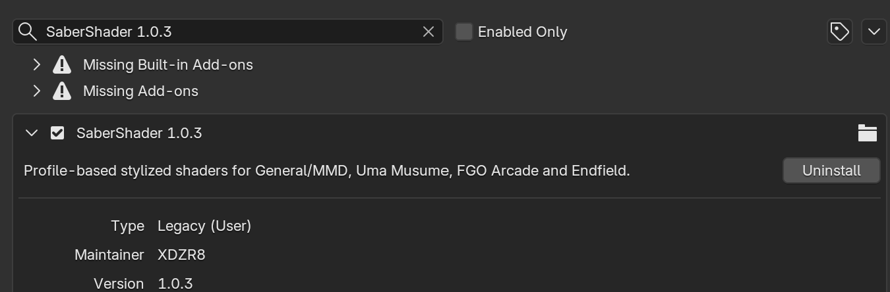

  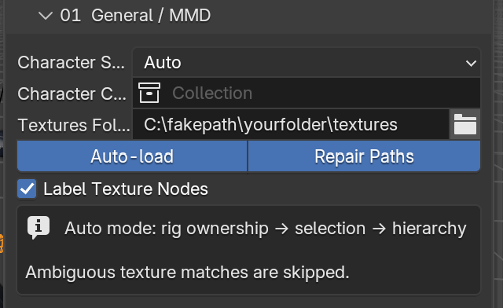

<strong>General / Advanced</strong> · 2 screenshots / capturas

  
  

<strong>Uma Musume</strong> · 3 screenshots / capturas

  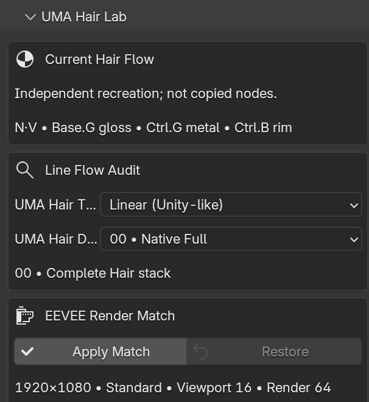

  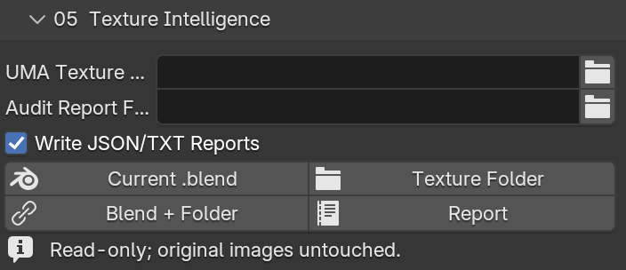

  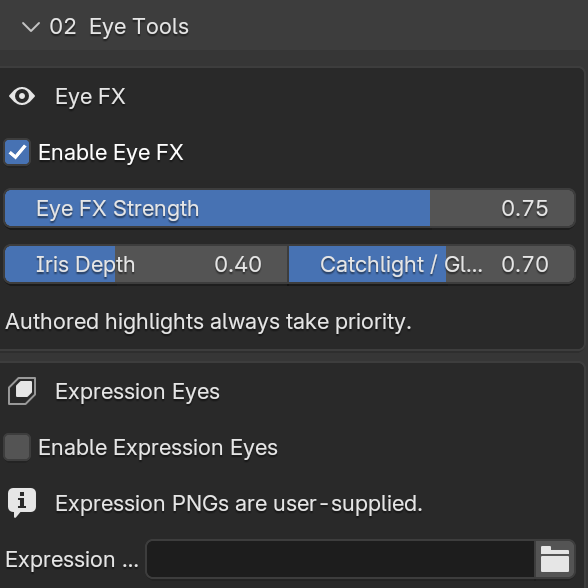

<strong>FGO Arcade</strong> · 3 screenshots / capturas

  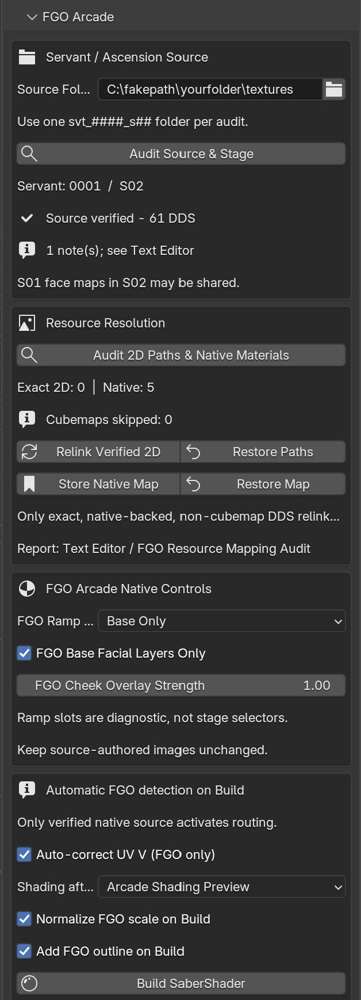

  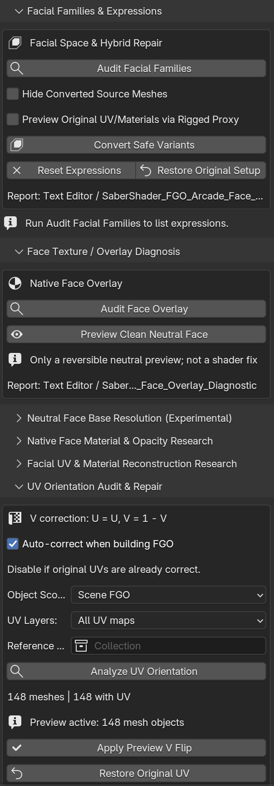

  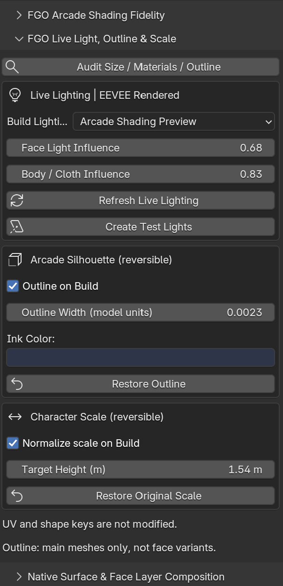

